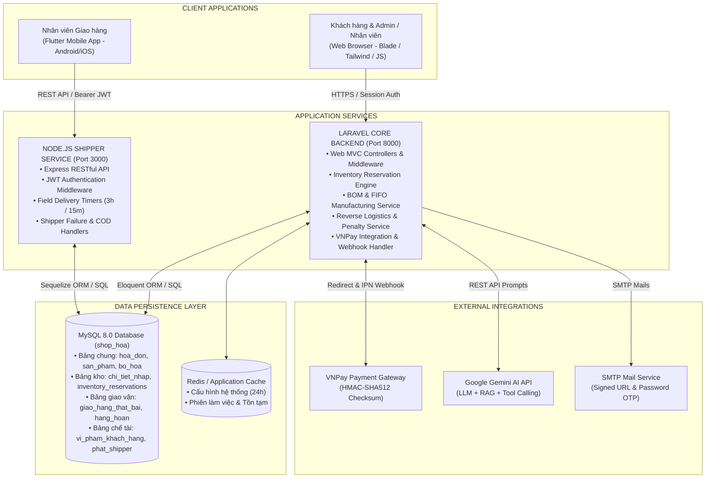
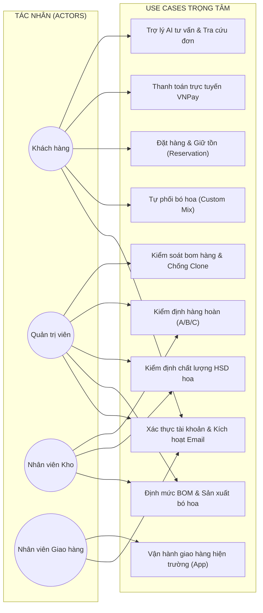
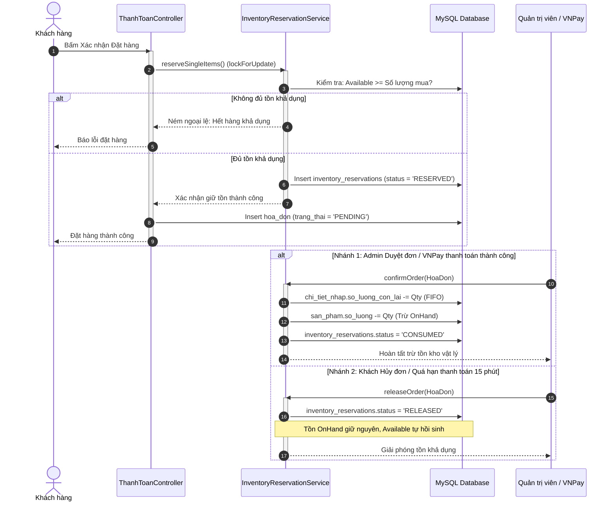
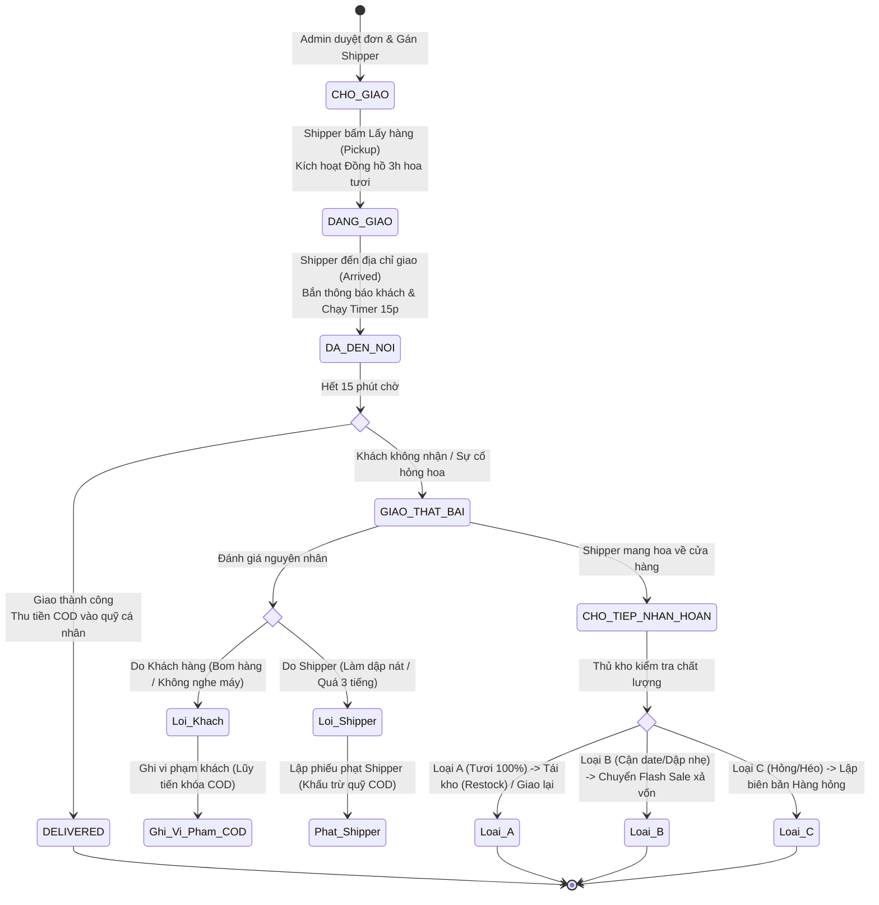

# 🌹 RoseShop – Nền Tảng Thương Mại Điện Tử & Quản Lý Kinh Doanh Hoa Tươi Đa Nền Tảng

> **Hệ thống thương mại điện tử chuyên biệt ngành hoa tươi**: Tích hợp quản trị chuỗi cung ứng khép kín từ **Nhập kho & Định mức nguyên vật liệu (BOM)** $\rightarrow$ **Sản xuất Bó hoa thành phẩm & Tính giá vốn (COGS)** $\rightarrow$ **Quản lý tồn kho giữ chỗ (Inventory Reservation) & Xuất kho FIFO** $\rightarrow$ **Bán lẻ & Tự phối hoa (Custom Mix)** $\rightarrow$ **Vận hành giao hàng hiện trường qua Mobile App Shipper** $\rightarrow$ **Xử lý hàng hoàn, kiểm soát rủi ro bom hàng COD & Trợ lý ảo AI (RoseBot)**.

---

## 📑 MỤC LỤC
1. [Tổng quan dự án (Project Overview)](#1-tổng-quan-dự-án-project-overview)
2. [Các chức năng chính (Key Features)](#2-các-chức-năng-chính-key-features)
3. [Ngăn xếp công nghệ (Technology Stack)](#3-ngăn-xếp-công-nghệ-technology-stack)
4. [Kiến trúc hệ thống (System Architecture)](#4-kiến-trúc-hệ-thống-system-architecture)
5. [Phân tích nghiệp vụ & Yêu cầu (Business Analysis & Requirements)](#5-phân-tích-nghiệp-vụ--yêu-cầu-business-analysis--requirements)
6. [Quy trình nghiệp vụ cốt lõi (Core Business Workflows)](#6-quy-trình-nghiệp-vụ-cốt-lõi-core-business-workflows)
7. [Giao diện hệ thống & Demo (Screenshots & Demo)](#7-giao-diện-hệ-thống--demo-screenshots--demo)
8. [Hướng dẫn cài đặt & Khởi chạy (Installation & Setup)](#8-hướng-dẫn-cài-đặt--khởi-chạy-installation--setup)
9. [Kiểm thử & Đảm bảo chất lượng (Testing & QA)](#9-kiểm-thử--đảm-bảo-chất-lượng-testing--qa)
10. [Tài liệu dự án (Project Documentation)](#10-tài-liệu-dự-án-project-documentation)
11. [Đội ngũ thực hiện & Đóng góp (Team & Contributions)](#11-đội-ngũ-thực-hiện--đóng-góp-team--contributions)
12. [Hiện trạng & Lộ trình phát triển (Status & Roadmap)](#12-hiện-trạng--lộ-trình-phát-triển-status--roadmap)

---

## 1. TỔNG QUAN DỰ ÁN (PROJECT OVERVIEW)

**RoseShop** là nền tảng thương mại điện tử hoa tươi đa nền tảng, được nghiên cứu và phát triển trong khuôn khổ **Đồ án Liên ngành (Interdisciplinary Capstone Project)** tại Trường Đại học Phenikaa. Hệ thống giải quyết trọn vẹn các bài toán kinh doanh đặc thù của ngành hoa tươi – một ngành hàng có tính chất sinh học nhạy cảm, vòng đời ngắn, dễ hư hỏng và đòi hỏi tay nghề chế tác thủ công.

Khác với các website bán hàng thông thường chỉ dừng lại ở việc mua bán sản phẩm tĩnh có sẵn, RoseShop số hóa toàn bộ chuỗi giá trị:
- **Chuỗi cung ứng & Sản xuất**: Quản lý nguyên vật liệu rời (cành hoa, giấy gói, ruy băng), định mức sản phẩm (BOM) và theo dõi hạn sử dụng theo từng lô nhập (Batch/Lot).
- **Cá nhân hóa trải nghiệm khách hàng**: Cung cấp công cụ tự phối bó hoa trực quan (Custom Mix) và Trợ lý ảo AI (RoseBot) hỗ trợ tư vấn ý nghĩa hoa, tra cứu đơn hàng thời gian thực.
- **Logistics hiện trường & Quản trị rủi ro**: Ứng dụng di động riêng cho Shipper với quy trình giao hàng nghiêm ngặt kèm đồng hồ đếm ngược hoa tươi, kiểm soát rủi ro "bom hàng" COD bằng chế tài phạt lũy tiến và quy trình kiểm định hàng hoàn 3 cấp độ (Tái kho / Flash Sale / Báo hỏng).

Hệ thống phục vụ 4 nhóm người dùng chính: **Khách hàng (Customer)**, **Quản trị viên (Administrator)**, **Nhân viên kho/cắm hoa (Staff / Inventory)** và **Nhân viên giao hàng (Shipper)**.

---

## 2. CÁC CHỨC NĂNG CHÍNH (KEY FEATURES)

> **Quy ước trạng thái xác thực:**
> - `[Implemented]`: Đã triển khai hoàn tất trong mã nguồn, có Feature Test tự động bảo vệ.
> - `[In Progress]`: Đang hoàn thiện giao diện hoặc tối ưu trải nghiệm.
> - `[Planned]`: Nằm trong kế hoạch mở rộng của tài liệu đồ án.

### 2.1. Phân hệ Quản trị viên (Administrator)
- `[Implemented]` **Dashboard phân tích điều hành**: Thống kê doanh thu theo đơn hoàn tất (`DELIVERED`), tổng đơn hàng, cảnh báo kho cạn, danh sách đơn chờ duyệt và biểu đồ doanh thu theo thời gian.
- `[Implemented]` **Quản lý Tài khoản & Phân quyền**: Quản lý tài khoản người dùng, phân quyền vai trò (Admin, Nhân viên, Khách hàng, Shipper), khóa/mở khóa tài khoản.
- `[Implemented]` **Quản trị Danh mục & Bó hoa**: Quản lý danh mục hoa bán lẻ, danh mục mẫu bó hoa (`mau_bo_hoa`), bảng cấu hình phụ phí gia công theo kích thước (`phu_phi_bo_hoa`).
- `[Implemented]` **Quản lý Nhà cung cấp & Lô hàng**: Hồ sơ nhà cung cấp (`nha_cung_cap`), đánh giá chất lượng lô nhập (`danh_gia_lo_hang`), quản lý hạn sử dụng từng lô.
- `[Implemented]` **Vòng đời Đơn hàng & Quản lý Hóa đơn**: Quản lý đơn hàng 6 tab chuyên biệt (Chờ duyệt, Đã duyệt, Đang giao, Đã giao, Giao thất bại, Đã hủy); lưu vết lý do và người hủy đơn.
- `[Implemented]` **Kiểm soát Shipper & Đối soát COD**: Theo dõi trạng thái trực tuyến của Shipper, kiểm soát quỹ tiền mặt COD shipper đang giữ (`tien_cod_hien_tai`), đối soát trạng thái nộp tiền.
- `[Implemented]` **Báo cáo Kế toán Quản trị**: Báo cáo Doanh thu & Lợi nhuận gộp bóc tách theo giá vốn nhập kho (COGS FIFO), Báo cáo hiệu suất giao hàng của Shipper, Báo cáo hàng hỏng và tổn thất tài chính.
- `[Implemented]` **Trung tâm Cấu hình Hệ thống Động**: Điều chỉnh tham số vận hành lưu Cache 24h (số ngày cảnh báo cận hạn, thời gian chờ giao hàng, bật/tắt cổng thanh toán).

### 2.2. Phân hệ Khách hàng (Customer)
- `[Implemented]` **Duyệt xem & Tìm kiếm sản phẩm**: Xem danh mục hoa bán lẻ, mẫu bó hoa có sẵn, bộ lọc giá và tìm kiếm từ khóa.
- `[Implemented]` **Giỏ hàng Bền vững (Cart Persistence)**: Lưu trữ đồng bộ giỏ hàng vào cơ sở dữ liệu (`khach_hang.du_lieu_gio_hang`), duy trì giỏ hàng khi đổi thiết bị.
- `[Implemented]` **Công cụ Tự thiết kế Bó hoa (Custom Mix)**: Khách hàng tự chọn kích thước (Size), hoa chính, hoa phụ, màu giấy gói, nơ; hệ thống validate hạn ngạch số cành, tính loại trừ và báo giá động tức thì.
- `[Implemented]` **Thanh toán Đa kênh & Sổ địa chỉ**: Quản lý nhiều địa chỉ nhận hàng, thanh toán tiền mặt (COD) hoặc thanh toán trực tuyến qua cổng VNPay bảo mật HMAC-SHA512.
- `[Implemented]` **Trợ lý Ảo AI (RoseBot)**: Chatbot thông minh ứng dụng Gemini LLM kết hợp RAG tri thức hoa từ `bot_knowledge` và Function Calling tra cứu đơn hàng thời gian thực.
- `[Implemented]` **Tự khắc phục vi phạm COD**: Xem danh sách đơn vi phạm bom hàng, thanh toán chi phí bồi hoàn qua VNPay để tự động gỡ phạt và khôi phục quyền mua COD.

### 2.3. Phân hệ Nhân viên & Kho (Staff / Inventory)
- `[Implemented]` **Nhập kho có kiểm soát**: Lập phiếu nhập (`DRAFT`), kiểm tra thực tế và xác nhận hoàn tất nhập kho (`CONFIRMED`); cơ chế hủy phiếu nhập an toàn có kiểm tra hoàn tồn.
- `[Implemented]` **Sản xuất Bó hoa theo định mức BOM**: Chọn mẫu bó hoa $\rightarrow$ Hệ thống kiểm tra đủ tồn nguyên liệu $\rightarrow$ Xuất nguyên liệu theo FIFO $\rightarrow$ Tạo bó hoa thành phẩm vật lý (`bo_hoa`) ở trạng thái `SAN_SANG`, chốt giá vốn snapshot và gán ngày hết hạn.
- `[Implemented]` **Kiểm định chất lượng hoa cận hạn/quá hạn**: Quét danh sách lô hoa và bó hoa cận hạn ($\le 2$ ngày) hoặc quá hạn $\rightarrow$ Thực hiện kiểm định chất lượng: *Gia hạn bán tiếp / Chuyển sang Flash Sale xả hàng / Lập biên bản Báo hỏng*.
- `[Implemented]` **Tiếp nhận & Kiểm định Hàng hoàn**: Tiếp nhận hoa do shipper mang về sau giao thất bại $\rightarrow$ Đánh giá chất lượng 3 cấp độ (Loại A: Tái kho / Loại B: Flash Sale / Loại C: Báo hỏng).

### 2.4. Phân hệ Nhân viên Giao hàng (Shipper)
- `[Implemented]` **Ứng dụng Di động chuyên biệt (Flutter)**: Ứng dụng chạy trên Android/iOS, giao diện Pink/Glassmorphism hiện đại, kết nối qua REST API với xác thực Bearer JWT.
- `[Implemented]` **Quản lý trạng thái làm việc**: Bật/tắt trạng thái trực tuyến (`ONLINE`/`OFFLINE`) và công tắc nhận đơn mới (`dang_nhan_don`).
- `[Implemented]` **Quy trình Giao hàng 5 bước Hiện trường**:
  1. Nhận danh sách đơn được phân công (`CHO_GIAO`).
  2. Bấm **Lấy hàng** (`pickup` $\rightarrow$ `DANG_GIAO`): Kích hoạt đồng hồ 3 giờ hoa tươi.
  3. Bấm **Đã đến nơi** (`arrived` $\rightarrow$ `DA_DEN_NOI`): Tự động thông báo cho khách và kích hoạt **Timer đếm ngược chờ tối thiểu 15 phút**.
  4. Bấm **Giao thành công** (`delivered`): Thu tiền COD, cập nhật đơn `DELIVERED`, cộng tiền vào quỹ COD cá nhân.
  5. Bấm **Báo giao thất bại**: Sau khi hết 15 phút chờ, chọn lý do lỗi Khách hàng hoặc Shipper.
- `[Implemented]` **Quản lý Lịch sử, Quỹ COD & Phiếu phạt**: Xem lịch sử giao hàng, số tiền COD cần nộp về quỹ cửa hàng và các phiếu phạt do làm hỏng hàng.

---

## 3. NGĂN XẾP CÔNG NGHỆ (TECHNOLOGY STACK)

| Phân tầng (Layer) | Công nghệ / Thư viện | Phiên bản thực tế | Vai trò trong hệ thống |
|---|---|:---:|---|
| **Web Frontend** | Blade Template, TailwindCSS, Alpine.js, Chart.js, Axios | Laravel 12.x stack | Giao diện Web phản hồi nhanh cho Khách hàng, Nhân viên và Quản trị viên Admin. |
| **Mobile App** | Flutter / Dart | Flutter 3.x | Ứng dụng di động đa nền tảng (Android/iOS) dành riêng cho Shipper vận hành ngoài hiện trường. |
| **Core Web Backend** | PHP / Laravel Framework | PHP 8.2+ / Laravel 12 | Xử lý toàn bộ logic nghiệp vụ cốt lõi, ORM Eloquent, MVC Architecture, Webhook VNPay. |
| **Shipper API Backend**| Node.js / Express Framework | Node.js 18+ | Microservice RESTful API chuyên biệt phục vụ ứng dụng di động Shipper, xác thực JWT. |
| **Database** | MySQL Server | MySQL 8.0+ | Cơ sở dữ liệu quan hệ dùng chung (`shop_hoa`), đồng bộ cấu trúc bảng và timezone `+07:00`. |
| **Caching & Session** | Redis / File Cache | Laravel Cache | Lưu trữ cấu hình hệ thống động 24h, session đăng nhập và token xác thực tạm thời. |
| **Payment Gateway** | Cổng thanh toán VNPay | VNPay Sandbox SDK | Xử lý thanh toán trực tuyến bảo mật mã hóa HMAC-SHA512 qua Return URL và IPN Webhook. |
| **Artificial Intelligence**| Google Gemini API / RAG | Gemini 1.5 Flash/Pro | Trợ lý ảo RoseBot: RAG tri thức hoa từ `bot_knowledge` và Function Calling tra cứu đơn hàng. |
| **Testing & QA** | PHPUnit | PHPUnit 11.5+ | Kiểm thử tự động toàn diện: Feature Tests, Business Rule Tests, Concurrency Tests. |

---

## 4. KIẾN TRÚC HỆ THỐNG (SYSTEM ARCHITECTURE)

Hệ thống được thiết kế theo kiến trúc **Module phân tán tích hợp chung CSDL (Distributed Modular Architecture with Shared Database)**:



> 📌 **Sơ đồ chi tiết:** Bản vẽ kiến trúc độ phân giải cao 4K được lưu trữ tại [`docs/architecture/RoseShop_System_Overview_4K.png`](docs/architecture/RoseShop_System_Overview_4K.png). Các sơ đồ lớp và Use Case UML chi tiết lưu tại thư mục [`docs/diagrams/`](docs/diagrams/).

---

## 5. PHÂN TÍCH NGHIỆP VỤ & YÊU CẦU (BUSINESS ANALYSIS & REQUIREMENTS)

Phần phân tích nghiệp vụ được thực hiện theo quy chuẩn kỹ thuật của một dự án phần mềm chuyên nghiệp:

### 5.1. Bảng ánh xạ Use Case chính (Core Use Cases)



### 5.2. Các quy tắc nghiệp vụ trọng tâm (Key Business Rules)

1. **BR-INV-01 (Công thức tồn kho 3 trạng thái)**:
   $$\text{Available (Tồn khả dụng)} = \text{OnHand (Tồn kho vật lý)} - \text{Reserved (Đang giữ chỗ)}$$
   Khách hàng chỉ được phép đặt hàng khi số lượng mua $\le \text{Available}$.
2. **BR-MFG-01 (Định mức BOM & Xuất kho FIFO)**:
   Mẫu bó hoa (`mau_bo_hoa`) không có tồn kho vật lý. Khi sản xuất $N$ bó hoa, hệ thống quét các lô nhập `chi_tiet_nhap` của từng nguyên liệu thành phần theo thứ tự ưu tiên còn hạn sử dụng (FIFO) để trừ tồn kho và tính tổng giá vốn snapshot.
3. **BR-EXP-01 (Nguyên tắc không tự động hủy hoa quá hạn)**:
   Hoa tươi đến hạn hoặc quá hạn **không bị hệ thống tự động xóa bỏ**. Bắt buộc phải qua quy trình Kiểm định chất lượng của nhân viên: Đạt $\rightarrow$ Gia hạn bán tiếp; Cận date $\rightarrow$ Bán Flash Sale; Hỏng $\rightarrow$ Xuất biên bản báo hỏng.
4. **BR-DLV-01 (Timer kiểm soát giao hàng)**:
   Khi nhận hoa đi giao, shipper có tối đa 3 tiếng để phát hàng. Khi đến nơi giao, shipper bấm `arrived`, hệ thống kích hoạt **Timer đếm ngược 15 phút**; trong thời gian này shipper bị khóa chức năng báo giao thất bại.
5. **BR-FRD-01 (Chế tài phạt bom hàng lũy tiến & Chống Clone)**:
   - Vi phạm 1 lần: Cảnh báo qua thông báo hệ thống.
   - Vi phạm 2 lần: Tự động khóa phương thức thanh toán tiền mặt (`CAM_COD`), bắt buộc thanh toán online qua VNPay.
   - Vi phạm $\ge 3$ lần: Khóa toàn bộ quyền mua sắm.
   - Khi đăng ký tài khoản mới: Quét đối soát Email và Số điện thoại; nếu trùng với hồ sơ đang có vi phạm `CAM_COD` chưa nộp phạt thì từ chối cấp tài khoản mới.

---

## 6. QUY TRÌNH NGHIỆP VỤ CỐT LÕI (CORE BUSINESS WORKFLOWS)

### 6.1. Quy trình Xử lý Đơn hàng & Giữ tồn kho (Inventory Reservation Lifecycle)



### 6.2. Quy trình Vận hành Giao hàng, Hàng hoàn & Phân định Trách nhiệm



---

## 7. GIAO DIỆN HỆ THỐNG & DEMO (SCREENSHOTS & DEMO)

Hệ thống sở hữu bộ giao diện hoàn chỉnh được thiết kế đồng bộ cho cả Web và Mobile App:

| STT | Phân hệ / Màn hình | Mô tả chức năng hiển thị | Vị trí tham chiếu trong mã nguồn |
|:---:|---|---|---|
| **1** | **Dashboard Tổng quan Quản trị** | Thống kê doanh thu đơn hoàn tất, tổng đơn hàng, cảnh báo kho cạn, danh sách đơn chờ duyệt và biểu đồ doanh thu theo thời gian. | [`resources/views/admin/AdminStaffDashboard.blade.php`](resources/views/admin/AdminStaffDashboard.blade.php) |
| **2** | **Công cụ Tự thiết kế Bó hoa (Custom Mix)** | Giao diện tương tác trực quan cho phép khách chọn kích thước, phối hoa chính, hoa phụ, màu giấy gói và nhận báo giá động tức thì. | [`resources/views/customer/bo-hoa/tu-tao.blade.php`](resources/views/customer/bo-hoa/tu-tao.blade.php) |
| **3** | **Quản lý Mẫu Bó hoa & Định mức BOM** | Thiết lập công thức cấu thành bó hoa, định mức từng loại cành/phụ kiện và cấu hình phụ phí gia công theo kích thước. | [`resources/views/admin/SanPham/BoHoa.blade.php`](resources/views/admin/SanPham/BoHoa.blade.php) |
| **4** | **Quản lý Tồn kho 3 Nhóm & HSD Lô hàng** | Bộ lọc tồn kho tách biệt Sản phẩm / Nguyên vật liệu / Bó hoa thành phẩm; cảnh báo HSD 4 cấp độ và nút kiểm định chất lượng. | [`resources/views/admin/TonKho/index.blade.php`](resources/views/admin/TonKho/index.blade.php) |
| **5** | **Vòng đời Đơn hàng 6 Tab** | Màn hình quản lý đơn đa trạng thái: Chờ duyệt, Đã duyệt, Đang giao, Đã giao, Giao thất bại (kèm nút kiểm tra hàng hoàn), Đã hủy. | [`resources/views/admin/DonHang/index.blade.php`](resources/views/admin/DonHang/index.blade.php) |
| **6** | **Trợ lý Ảo AI RoseBot** | Khung chat AI thông minh hỗ trợ khách hàng tư vấn hoa, gợi ý phối màu Custom Mix và gọi hàm tra cứu đơn hàng real-time. | [`resources/views/customer/chatbot/index.blade.php`](resources/views/customer/chatbot/index.blade.php) |
| **7** | **Ứng dụng Di động Shipper (Flutter)** | Màn hình điện thoại hiển thị công tắc Online, danh sách đơn được gán, 3 nút hành động (Pickup / Arrived / Delivered) và Timer 15p. | Thư mục `shipper_fe/lib/screens/` |

> 📷 **Danh sách ảnh giao diện:** Các ảnh chụp màn hình thực tế của hệ thống được lưu trữ tại thư mục [`public/img/`](public/img/) và tài liệu báo cáo `N02_BaiTap_2_1...pdf` (Trang 21–22).

---

## 8. HƯỚNG DẪN CÀI ĐẶT & KHỞI CHẠY (INSTALLATION & SETUP)

### 8.1. Yêu cầu môi trường tiên quyết
- **PHP**: Phiên bản 8.2 trở lên (bật các extension `pdo_mysql`, `mbstring`, `openssl`, `curl`, `bcmath`).
- **Composer**: Phiên bản 2.x.
- **Node.js & NPM**: Node.js 18.x trở lên.
- **MySQL**: Phiên bản 8.0 trở lên.
- **Flutter SDK** *(nếu chạy Shipper Mobile App)*: Phiên bản 3.x.

### 8.2. Khởi chạy Core Web Backend (Laravel)
```bash
# 1. Di chuyển vào thư mục dự án
cd RoseShop_TMDT

# 2. Cài đặt các gói phụ thuộc PHP và Node
composer install
npm install

# 3. Tạo file cấu hình môi trường
cp .env.example .env
php artisan key:generate

# 4. Cấu hình thông tin cơ sở dữ liệu trong file .env
# DB_CONNECTION=mysql
# DB_HOST=127.0.0.1
# DB_PORT=3306
# DB_DATABASE=shop_hoa
# DB_USERNAME=root
# DB_PASSWORD=your_password

# 5. Chạy Migration và nạp dữ liệu mẫu Seeder
php artisan migrate --seed

# 6. Biên dịch tài nguyên giao diện và khởi động máy chủ Web
npm run build
php artisan serve
# Hệ thống Web hoạt động tại: http://127.0.0.1:8000
```

### 8.3. Khởi chạy Shipper API Backend (Node.js Express)
```bash
# 1. Di chuyển vào thư mục backend Shipper
cd shipper_be

# 2. Cài đặt các gói phụ thuộc
npm install

# 3. Cấu hình biến môi trường kết nối MySQL (file .env trong shipper_be)
# PORT=3000
# DB_HOST=127.0.0.1
# DB_PORT=3306
# DB_DATABASE=shop_hoa
# DB_USERNAME=root
# DB_PASSWORD=your_password
# JWT_SECRET=your_jwt_secret_key

# 4. Khởi động máy chủ API
npm run dev
# Máy chủ Shipper API hoạt động tại: http://127.0.0.1:3000
```

### 8.4. Khởi chạy Ứng dụng Di động Shipper (Flutter)
```bash
# 1. Di chuyển vào thư mục ứng dụng Shipper
cd shipper_fe

# 2. Lấy các gói phụ thuộc Flutter
flutter pub get

# 3. Khởi chạy trên máy ảo hoặc thiết bị thật
flutter run
```

### 8.5. Tài khoản demo kiểm thử hệ thống

| Vai trò người dùng | Tên đăng nhập | Mật khẩu mặc định | Ghi chú quyền hạn |
|---|---|:---:|---|
| **Quản trị viên (Admin)** | `admin` | `password` | Toàn quyền kiểm soát hệ thống, kho, nhân sự và báo cáo. |
| **Nhân viên (Staff)** | `nv1` hoặc `trongNV` | `password` | Quản lý kho, lập phiếu nhập, sản xuất bó hoa và duyệt đơn. |
| **Nhân viên Giao hàng (Shipper)** | `shipper1` hoặc `An_SHIP` | `password` | Đăng nhập trên cả Web và Ứng dụng di động Shipper Flutter. |
| **Khách hàng (Customer)** | `kh1` hoặc `manh` | `password` | Mua hàng, Custom Mix, tương tác RoseBot, sổ địa chỉ. |

---

## 9. KIỂM THỬ & ĐẢM BẢO CHẤT LƯỢNG (TESTING & QA)

Dự án áp dụng phương pháp kiểm thử tự động toàn diện (**Automated Feature Testing**) với hơn **20 bộ test suite** hoàn chỉnh, bao phủ toàn bộ các quy tắc nghiệp vụ nhạy cảm:

### 9.1. Các nhóm kiểm thử tiêu biểu

```
tests/Feature/
├── UC11_RegisterAccountTest.php             # Kiểm thử đăng ký & xác thực email OTP
├── PasswordResetFeatureTest.php             # Kiểm thử quên & đặt lại mật khẩu an toàn
├── UC41_SupplierManagementTest.php          # Kiểm thử quản lý Nhà cung cấp & đánh giá lô nhập
├── UC42_HuyPhieuNhapTest.php                # Kiểm thử chặn hủy phiếu nhập khi hàng đã xuất
├── UC43_LoHangManagementTest.php            # Kiểm thử quản lý lô hàng & hạn sử dụng
├── UC44_InventoryReservationTest.php        # Kiểm thử 16 kịch bản tồn kho 3 trạng thái & FIFO
├── UC_TonKhoBoHoaBusinessRulesTest.php      # Kiểm thử quy tắc định mức BOM & tạo bó hoa
├── CustomerCustomMixTest.php                # Kiểm thử hạn ngạch size, tính loại trừ Custom Mix
├── CustomerViolationBusinessTest.php        # Kiểm thử 15 ca vi phạm bom hàng & khóa/gỡ COD
├── SanPhamHetHanFlashSaleBusinessTest.php   # Kiểm thử vòng đời HSD hoa và chiến dịch Flash Sale
├── AdminDonHangLifecycleTest.php            # Kiểm thử vòng đời 6 tab đơn hàng & hủy hoàn tồn
├── BaoCaoDoanhThuLoiNhuanTest.php           # Kiểm thử tính đúng giá vốn COGS FIFO & lợi nhuận
└── RoseBotFeatureTest.php                   # Kiểm thử RAG tri thức hoa & Function Calling tra đơn
```

### 9.2. Minh họa kết quả thực thi kiểm thử thực tế

Chạy kiểm thử trực tiếp trên môi trường máy chủ:
```bash
# Kiểm thử toàn diện cơ chế giữ tồn kho và kiểm soát bán vượt
php artisan test tests/Feature/UC44_InventoryReservationTest.php
# Kết quả: PASS (16 tests, 84 assertions) - 0.42s

# Kiểm thử chính sách vi phạm bom hàng và khóa/gỡ COD qua VNPay
php artisan test tests/Feature/CustomerViolationBusinessTest.php
# Kết quả: PASS (15 tests, 72 assertions) - 0.38s

# Kiểm thử bộ lọc loại tồn kho 3 nhóm độc lập
php artisan test tests/Feature/TonKhoFilterLoaiTest.php
# Kết quả: PASS (7 tests, 117 assertions) - 0.54s
```

---

## 10. TÀI LIỆU DỰ ÁN (PROJECT DOCUMENTATION)

Toàn bộ tài liệu phân tích thiết kế chính thức của dự án được lưu trữ trong thư mục [`docs/`](docs/) của repository:

| Loại tài liệu | Tên tài liệu / Đường dẫn | Mô tả nội dung kỹ thuật |
|---|---|---|
| **System Architecture** | [`docs/architecture/RoseShop_System_Overview_4K.png`](docs/architecture/RoseShop_System_Overview_4K.png) | Sơ đồ kiến trúc tổng quan độ phân giải cao 4K thể hiện đầy đủ các phân tầng. |
| **Use Case Diagrams** | [`docs/diagrams/RoseShop_UML_GonGong (2).drawio`](docs/diagrams/RoseShop_UML_GonGong%20(2).drawio) | File thiết kế Draw.io chứa toàn bộ sơ đồ Use Case tổng quát và sơ đồ Use Case phân hệ. |
| **Class Diagram** | [`docs/diagrams/RoseShop_UML_ClassDiagram_CoTenQuanHe.drawio`](docs/diagrams/RoseShop_UML_ClassDiagram_CoTenQuanHe.drawio) | Sơ đồ lớp chi tiết có định danh tên quan hệ thực thể, thuộc tính và phương thức. |
| **Requirements Spec** | `N02_BaiTap_2_1_Xây dựng sơ đồ Use-case (1).pdf` | Tài liệu phân tích yêu cầu (URD/SRS), danh mục yêu cầu R1–R11 và đặc tả Use Case chi tiết. |
| **Project Proposal** | `N02_Proposal_01_03092026.pdf` | Đề xuất dự án, mục tiêu, 6 nhiệm vụ trọng tâm và kết quả bàn giao được phê duyệt. |
| **Meeting Minutes** | `N02_MeetingMinutesReport_01...pdf`, `03...pdf` | Biên bản họp nhóm với Giảng viên hướng dẫn ghi nhận phản hồi và quyết định thay đổi nghiệp vụ. |

---

## 11. ĐỘI NGŨ THỰC HIỆN & ĐÓNG GÓP (TEAM & CONTRIBUTIONS)

Dự án được xây dựng bởi **Nhóm 5 – Đồ án Liên ngành (CSE703014)**, Khoa Công nghệ Thông tin, Trường Đại học Phenikaa dưới sự hướng dẫn chuyên môn của **TS. Mai Thúy Nga**.

| Thành viên | Mã sinh viên | Vai trò chính | Phạm vi trách nhiệm đóng góp |
|---|:---:|---|---|
| **Nguyễn Thị Kiều Trinh** | `23010632` | **Trưởng nhóm / BA Lead / Fullstack** | • Khảo sát bài toán nghiệp vụ, xây dựng tài liệu URD, SRS, Use Case và Business Rules.<br>• Thiết kế kiến trúc CSDL quan hệ, thiết kế mô hình BOM, Inventory Reservation.<br>• Lập trình Core Backend (Laravel), tích hợp cổng VNPay, Trợ lý ảo AI RoseBot.<br>• Xây dựng kịch bản UAT và viết các bộ kiểm thử tự động Feature Test. |
| **Nguyễn Kiều Trang** | `23010495` | **Business Analyst / Frontend** | • Tham gia khảo sát yêu cầu người dùng và viết tài liệu đặc tả Use Case.<br>• Thiết kế giao diện người dùng Web (Blade, TailwindCSS) và trải nghiệm Custom Mix.<br>• Hỗ trợ kiểm thử thủ công giao diện (UI/UX Testing) và chuẩn hóa tài liệu báo cáo. |
| **Dương Hùng Mạnh** | `23010597` | **Mobile Developer / QA** | • Phát triển ứng dụng di động Shipper trên nền tảng Flutter (Android/iOS).<br>• Tham gia xây dựng các endpoint RESTful API trên Shipper Backend (Node.js).<br>• Thực thi kiểm thử tích hợp giữa Mobile App và Backend, kiểm thử Timer giao hàng. |

---

## 12. HIỆN TRẠNG & LỘ TRÌNH PHÁT TRIỂN (STATUS & ROADMAP)

### 12.1. Đã hoàn thành (Completed)
- [x] Hệ thống Web bán hàng Khách hàng và Cổng quản trị Admin hoàn chỉnh.
- [x] Quản lý Định mức nguyên liệu (BOM), sản xuất bó hoa thành phẩm và chốt giá vốn snapshot (COGS).
- [x] Quản lý tồn kho 3 trạng thái *(OnHand - Reserved - Available)* kết hợp cơ chế Reservation chống bán âm.
- [x] Công cụ tự phối bó hoa Custom Mix với báo giá tức thì và ràng buộc loại trừ.
- [x] Ứng dụng di động Flutter dành riêng cho Shipper kết nối REST API Node.js.
- [x] Quy trình xử lý hàng hoàn sau giao thất bại (Loại A/B/C) và tự động phạt trách nhiệm Shipper.
- [x] Hệ thống kiểm soát rủi ro bom hàng COD, khóa COD lũy tiến và thanh toán gỡ vi phạm qua VNPay.
- [x] Trợ lý ảo AI RoseBot ứng dụng Gemini LLM kết hợp RAG tri thức hoa và Function Calling tra cứu đơn hàng.
- [x] Hơn 20 bộ Automated Feature Test bảo vệ toàn bộ các luồng nghiệp vụ cốt lõi.

### 12.2. Đang hoàn thiện & Tối ưu (In Progress)
- [ ] Tối ưu hóa hiệu năng giao diện Web trên các thiết bị màn hình nhỏ (Mobile Web Responsive).
- [ ] Hoàn thiện quyển báo cáo tổng kết đồ án liên ngành và slide thuyết trình bảo vệ trước Hội đồng.

### 12.3. Định hướng phát triển trong tương lai (Planned Roadmap)
- [ ] **Tích hợp bản đồ GPS thời gian thực**: Nâng cấp ứng dụng Shipper tích hợp Google Maps API để khách hàng theo dõi vị trí shipper di chuyển theo thời gian thực.
- [ ] **Mở rộng ví điện tử**: Bổ sung cổng thanh toán MoMo và Apple Pay / Google Pay.
- [ ] **Triển khai hạ tầng Container**: Đóng gói toàn bộ hệ thống bằng Docker và Docker Compose phục vụ triển khai Multi-container trên môi trường Cloud (AWS / DigitalOcean).

---

<div align="center">
  <sub>Dự án được xây dựng phục vụ học tập và nghiên cứu khoa học tại Trường Đại học Phenikaa • 2026</sub>
</div>
