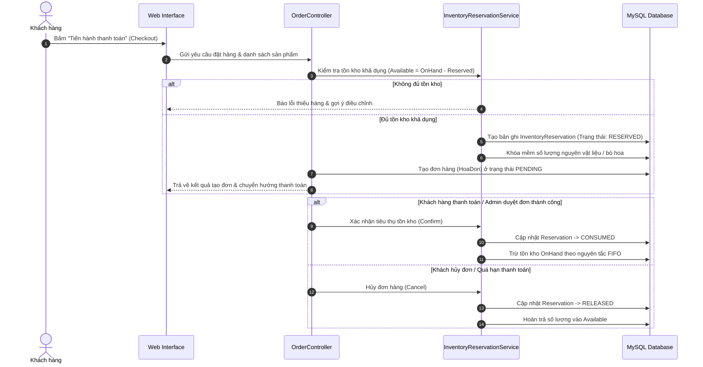
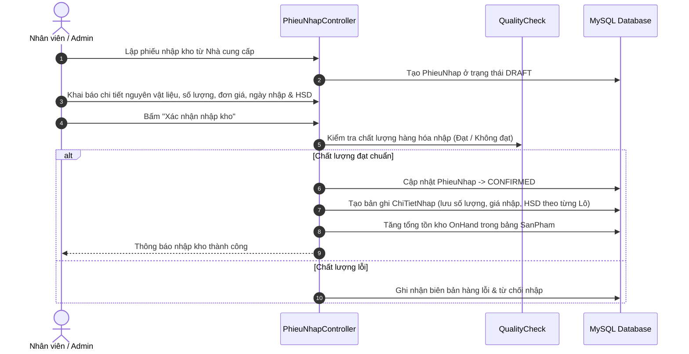
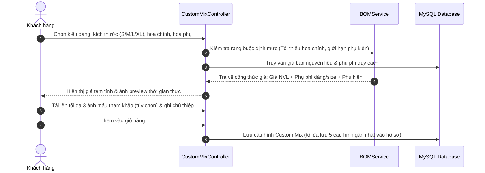
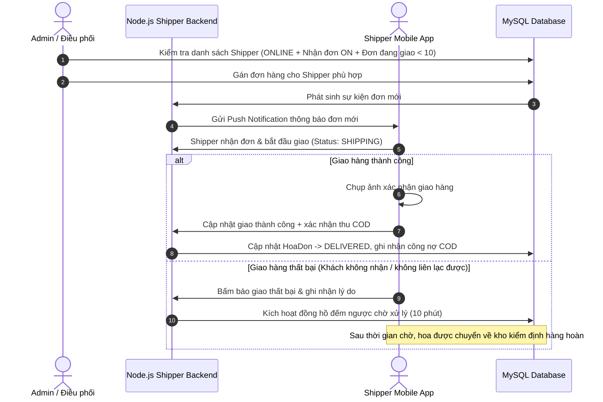
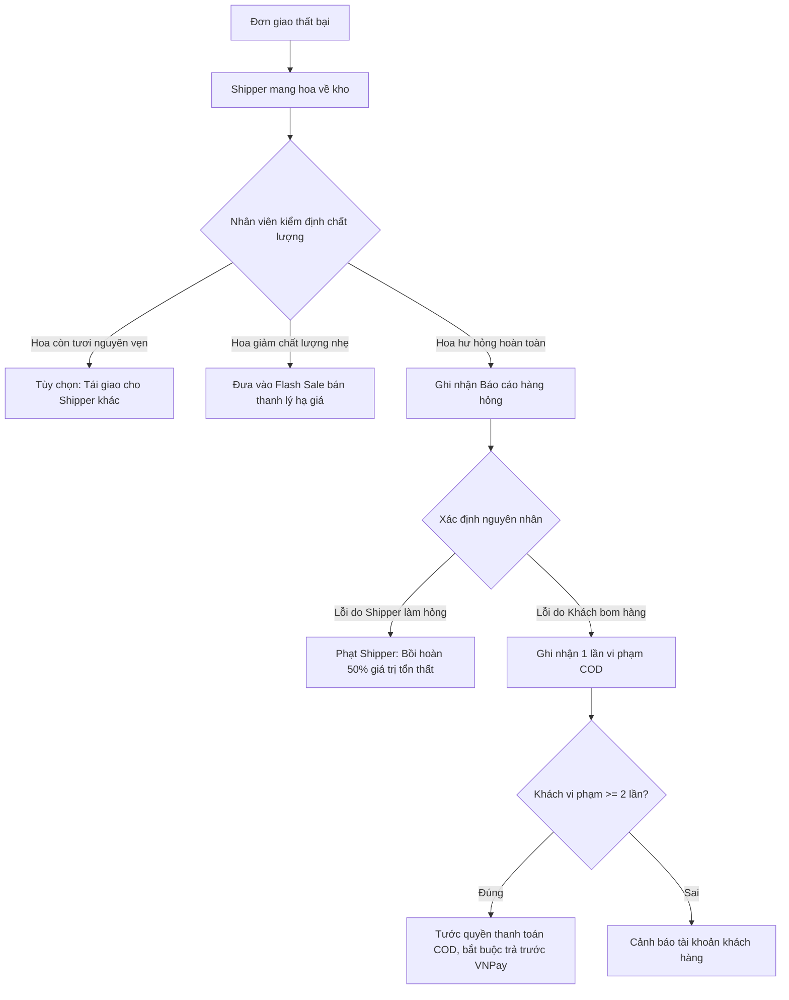
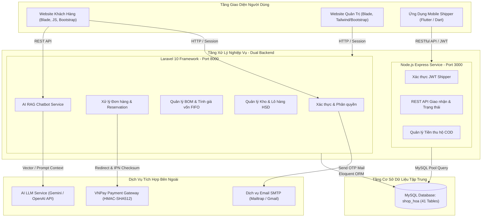
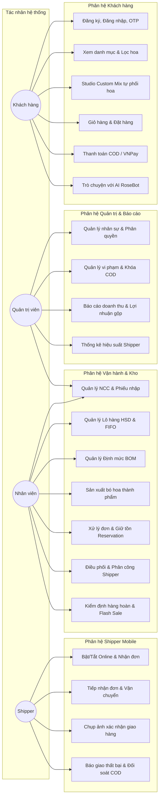
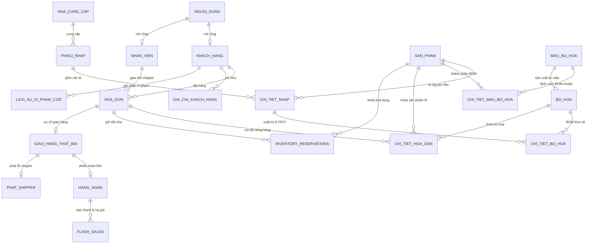

# ROSESHOP — HỆ THỐNG BÁN HOA TRỰC TUYẾN ĐA NỀN TẢNG TÍCH HỢP TRÍ TUỆ NHÂN TẠO

> **ĐỒ ÁN LIÊN NGÀNH HỆ THỐNG THÔNG TIN — ĐẠI HỌC PHENIKAA**  
> **Khoá:** K17 (2023 – 2027) | **Lớp học phần:** CSE703014-1-1-26(N02)  
> **Giảng viên hướng dẫn:** TS. Mai Thúy Nga  
> **Sinh viên thực hiện:**  
> - **Nguyễn Thị Kiều Trinh** (23010632) — *Trưởng nhóm / Senior BA & Fullstack Engineer*  
> - **Nguyễn Kiều Trang** (23010495) — *Business Analyst & Frontend Engineer*  
> - **Dương Hùng Mạnh** (23010597) — *Mobile Flutter Engineer & QA Engineer*  

---

## MỤC LỤC TỔNG QUAN

1. [Project Overview](#1-project-overview)
2. [Problem & Objectives](#2-problem--objectives)
3. [Scope](#3-scope)
4. [Actors & Roles](#4-actors--roles)
5. [Business Flow](#5-business-flow)
6. [Features & Modules](#6-features--modules)
7. [System Architecture](#7-system-architecture)
8. [Technology Stack](#8-technology-stack)
9. [Database Design](#9-database-design)
10. [API & Integration](#10-api--integration)
11. [Project Structure](#11-project-structure)
12. [Installation & Setup](#12-installation--setup)
13. [Development Guide](#13-development-guide)
14. [Testing & Quality Assurance](#14-testing--quality-assurance)
15. [BA Documentation & Business Rules](#15-ba-documentation--business-rules)
16. [Diagrams & Visualizations](#16-diagrams--visualizations)
17. [Security & Compliance](#17-security--compliance)
18. [Deployment & Operations](#18-deployment--operations)
19. [Team & Contribution](#19-team--contribution)
20. [Documentation Index](#20-documentation-index)

---

## 1. PROJECT OVERVIEW

**RoseShop** là hệ thống thương mại điện tử chuyên biệt ngành hoa tươi đa nền tảng, được kế thừa và phát triển vượt bậc từ Đồ án cơ sở lên Đồ án liên ngành. Hệ thống giải quyết trọn vẹn chuỗi cung ứng hoa tươi khép kín: từ **quản lý nguồn cung**, **nhập kho theo lô & hạn sử dụng (HSD)**, **định mức nguyên vật liệu (BOM)**, **sản xuất bó hoa thành phẩm FIFO**, **khách hàng tự thiết kế bó hoa cá nhân hóa (Custom Mix)**, **kiểm soát tồn kho thời gian thực chống bán vượt tồn (Inventory Reservation)**, **tư vấn thông minh AI RoseBot (RAG + LLM)**, **thanh toán điện tử bảo mật VNPay (HMAC-SHA512)** cho đến **tác nghiệp giao hàng di động chuyên biệt cho Shipper (Flutter Mobile App)** và **xử lý hàng hoàn, kiểm soát rủi ro vi phạm COD**.

```
+----------------------------------------------------------------------------------------------------+
|                                      HỆ THỐNG ROSESHOP ĐA NỀN TẢNG                                 |
+-----------------------------------+--------------------------------+-------------------------------+
|       KHÁCH HÀNG (WEB)            |       QUẢN TRỊ VIÊN (WEB)      |        SHIPPER (MOBILE)       |
|  - Mua hoa có sẵn / Flash Sale    |  - Quản trị kho lô hàng & HSD  |  - Trạng thái Online/Nhận đơn |
|  - Tự phối Custom Mix thời gian thực| - Định mức BOM & sản xuất FIFO |  - Tiếp nhận đơn & điều hướng |
|  - Trợ lý tư vấn AI RoseBot       |  - Giữ tồn kho Reservation     |  - Chụp ảnh giao hàng thành công|
|  - Thanh toán COD & VNPay QR      |  - Phân công & điều phối Shipper| - Báo giao thất bại & đối soát|
+-----------------------------------+--------------------------------+-------------------------------+
```

---

## 2. PROBLEM & OBJECTIVES

### 2.1. Đặt vấn đề trong kinh doanh hoa tươi
Trong ngành bán lẻ hoa tươi, các website thương mại điện tử truyền thống gặp phải các rào cản nghiệp vụ nghiêm trọng:
1. **Hoa tươi có vòng đời ngắn, dễ hao hụt**: Tồn kho không thể chỉ quản lý ở cấp thành phẩm mà phải kiểm soát ở cấp độ nguyên liệu (từng bông hoa, cành lá, giấy gói, ruy băng, xốp cắm) gắn chặt với ngày nhập và hạn tươi (HSD) từng lô.
2. **Định giá và tính giá vốn bó hoa phức tạp**: Một bó hoa gồm nhiều nguyên liệu thuộc các lô nhập có đơn giá khác nhau. Tính thủ công dễ sai lệch giá vốn, khó hoạch định lãi gộp và giá bán cạnh tranh.
3. **Nhu cầu cá nhân hóa cao (Custom Mix)**: Khách hàng muốn tự chọn kiểu dáng, kích thước, từng loại hoa và phụ kiện, nhưng hệ thống phải kiểm soát được khả dụng nguyên liệu tức thời để không nhận đơn bất khả thi.
4. **Hiện tượng bán vượt tồn kho (Overselling)**: Khi nhiều khách hàng cùng đặt một loại hoa tại các thời điểm cao điểm (ngày lễ 8/3, 20/10, Valentine), nếu trừ kho ngay khi thêm giỏ hàng sẽ bị găm hàng ảo, nếu trừ kho sau khi thanh toán sẽ bị xung đột hết hàng.
5. **Rào cản tư vấn trực tuyến**: Khách hàng thiếu kiến thức về ý nghĩa hoa, tone màu, dịp tặng và ngân sách nếu không có nhân viên trực tiếp hỗ trợ.
6. **Bất cập trong tác nghiệp Shipper trên Web**: Shipper di chuyển ngoài đường cần ứng dụng di động có định vị, camera chụp ảnh bằng chứng giao hàng, đồng hồ đếm ngược chờ khách và kiểm soát thu hộ tiền mặt (COD).

### 2.2. Mục tiêu hệ thống
* **Chuẩn hóa quản lý kho nguyên vật liệu**: Nhập kho theo lô (`chi_tiet_nhap`), quản lý HSD, cảnh báo cận hạn, kiểm tra chất lượng (QC), tính giá vốn tự động theo nguyên tắc **FIFO**.
* **Định mức kỹ thuật BOM (Bill of Materials)**: Cấu hình công thức chuẩn cho mẫu bó hoa theo Size (S, M, L, XL, XXL, Special) và Dáng (Tròn, Dài, Tự nhiên, Thác đổ, Giỏ hoa).
* **Kiểm soát tồn kho 3 tầng qua Inventory Reservation**: Quản lý rành mạch ba chỉ số `OnHand` (Tồn thực tế), `Reserved` (Tồn đang giữ), `Available` (Khả dụng = OnHand - Reserved), triệt tiêu hoàn toàn lỗi bán vượt tồn.
* **Cung cấp Studio Custom Mix**: Cho phép khách hàng tự thiết kế bó hoa với công thức tính giá động theo thời gian thực và lưu giữ 5 cấu hình gần nhất.
* **Tích hợp trợ lý ảo AI RoseBot**: Ứng dụng mô hình ngôn ngữ lớn kết hợp cơ chế truy hồi tri thức (RAG) từ dữ liệu sản phẩm, chính sách và cẩm nang hoa tươi của cửa hàng.
* **Số hóa giao vận qua Flutter Mobile App & Node.js Backend**: Quản lý trạng thái Online/Offline, giới hạn tải tối đa 10 đơn/shipper, đồng hồ chờ khách 10 phút, đối soát COD và chế tài hàng hoàn.

---

## 3. SCOPE

### 3.1. Phạm vi trong dự án (In-Scope)
* **Phân hệ Web Khách hàng**: Tìm kiếm, bộ lọc đa tiêu chí, xem chi tiết, giỏ hàng Session-DB sync, Studio Custom Mix, đặt hàng, thanh toán COD/VNPay, tra cứu đơn hàng, tương tác AI RoseBot.
* **Phân hệ Web Quản trị (Admin/Staff)**: Quản lý người dùng, nhân viên, khách hàng; quản lý danh mục sản phẩm, nguyên vật liệu, mẫu bó hoa BOM, sản xuất bó hoa thành phẩm; quản lý nhà cung cấp, phiếu nhập, lô hàng HSD; quản lý đơn hàng, điều phối giao vận, hàng hoàn, Flash Sale thanh lý, xử lý vi phạm COD; Dashboard báo cáo doanh thu, chi phí, lợi nhuận thực tế.
* **Phân hệ Di động Shipper (Mobile Flutter App)**: Đăng nhập tài khoản shipper, quản lý trạng thái trực tuyến / nhận đơn, tiếp nhận phân công, định vị dẫn đường, chụp ảnh xác nhận giao hàng, báo giao thất bại, thống kê công nợ COD.
* **Backend kép (Dual Backend Architecture)**: Laravel Core API (Web/Admin/Inventory/AI) + Node.js Express API (Mobile Shipper API).
* **Cơ sở dữ liệu tập trung**: Hệ quản trị MySQL `shop_hoa` gồm 41 bảng dữ liệu chuẩn hóa.

### 3.2. Ngoài phạm vi dự án (Out-of-Scope)
* Tự động điều phối Shipper tối ưu theo giải thuật tìm đường thông minh TSP/GIS (Hiện tại hỗ trợ phân công bán tự động do Admin/Nhân viên click chọn dựa trên danh sách Shipper khả dụng và tải thực tế).
* Giao dịch tài chính thật ngoài cổng Sandbox của VNPay (Đảm bảo tuân thủ ràng buộc đồ án sinh viên).
* AI tự động chỉnh sửa cơ sở dữ liệu hoặc tự động xác nhận đơn hàng (AI tuân thủ ràng buộc đạo đức: chỉ tư vấn và hỗ trợ khách hàng, không can thiệp dữ liệu nghiệp vụ).

---

## 4. ACTORS & ROLES

| Tác nhân (Actor) | Vai trò hệ thống | Trách nhiệm và quyền hạn chính |
| :--- | :--- | :--- |
| **Khách hàng** *(Customer)* | `KHACH_HANG` | Duyệt danh mục sản phẩm, tùy biến bó hoa Custom Mix, tương tác với AI RoseBot, quản lý giỏ hàng, đặt hàng, thanh toán trực tuyến qua VNPay, theo dõi trạng thái giao hàng, nộp phạt vi phạm COD để mở khóa tài khoản. |
| **Quản trị viên** *(Admin)* | `ADMIN` | Quản lý toàn bộ hệ thống; cấu hình tham số hệ thống; quản lý tài khoản người dùng, nhân viên, shipper; xem báo cáo doanh thu, chi phí, lợi nhuận gộp; thiết lập phụ phí, phê duyệt phiếu nhập và điều chỉnh tồn kho. |
| **Nhân viên cửa hàng** *(Staff)* | `NHAN_VIEN` | Tạo phiếu nhập kho, kiểm định chất lượng lô hàng (QC), quản lý nguyên vật liệu, thiết lập mẫu bó hoa BOM, thực hiện sản xuất bó hoa theo FIFO, xác nhận đơn hàng, phân công shipper, kiểm tra hoa hoàn về và tổ chức Flash Sale. |
| **Nhân viên giao hàng** *(Shipper)* | `SHIPPER` | Sử dụng Mobile App; bật/tắt trạng thái Online và Nhận đơn; tiếp nhận đơn hàng được giao; cập nhật tiến trình vận chuyển; chụp ảnh bằng chứng giao thành công; ghi nhận lý do giao thất bại; nộp đối soát tiền mặt COD. |
| **Hệ thống AI** *(RoseBot)* | `AI_SERVICE` | Tiếp nhận câu hỏi ngôn ngữ tự nhiên; truy xuất tri thức RAG (`bot_knowledge`); tư vấn mẫu hoa theo ngân sách, cảm xúc, đối tượng; gợi ý thành phần Custom Mix; hỗ trợ tra cứu tiến độ đơn hàng. |
| **Cổng thanh toán** *(Payment Gateway)* | `VNPAY` | Cung cấp giao diện thanh toán an toàn, xác minh chữ ký số bảo mật HMAC-SHA512, phản hồi kết quả giao dịch về hệ thống qua Webhook IPN. |

---

## 5. BUSINESS FLOW

### 5.1. Luồng mua hàng & Cơ chế Giữ tồn kho (Inventory Reservation)



### 5.2. Luồng Quản lý nhập kho & Phân bổ FIFO



### 5.3. Luồng Khách hàng tự phối hoa (Custom Mix Studio)



### 5.4. Luồng Phân công giao vận & Tác nghiệp Shipper Mobile



### 5.5. Luồng xử lý hàng hoàn về & Chế tài vi phạm



---

## 6. FEATURES & MODULES

Dự án được phân rã thành **11 nhóm yêu cầu chức năng (R1 – R11)** tương ứng với **40+ Use Cases chi tiết**:

| Nhóm chức năng | Mã YC | Use Cases tương ứng | Mô tả nghiệp vụ chính |
| :--- | :--- | :--- | :--- |
| **Xác thực & Truy cập** | **R1** | `UC1.1` – `UC1.4` | Đăng ký xác thực email, đăng nhập phân quyền đa vai trò, quên mật khẩu qua OTP 6 số (hiệu lực 60 phút), đăng xuất an toàn. |
| **Quản trị Nhân sự & Khách** | **R2** | `UC2.1` – `UC2.4` | Quản lý tài khoản hệ thống (khóa/mở khóa logic, không xóa vật lý), quản lý nhân viên theo chức vụ/lương, theo dõi điểm tích lũy khách hàng, quản lý danh sách Shipper. |
| **Sản phẩm, Mẫu bó & BOM** | **R3** | `UC3.1` – `UC3.5` | Quản lý danh mục hoa lẻ, nguyên vật liệu; cấu hình định mức BOM cho mẫu bó hoa; tính giá vốn tự động theo FIFO; quản lý thuộc tính concept/dịp/kiểu dáng. |
| **Quản lý Kho & Nhập hàng** | **R4** | `UC4.1` – `UC4.4` | Quản lý nhà cung cấp; lập và duyệt phiếu nhập; theo dõi lô hàng HSD; kiểm soát tồn kho 3 tầng (OnHand, Reserved, Available); xử lý hủy lô hết hạn. |
| **Mua hàng & Custom Mix** | **R5** | `UC5.1` – `UC5.4` | Danh mục lọc đa tiêu chí; giỏ hàng tự động đồng bộ; Studio Custom Mix phối hoa theo ý muốn; Checkout kiểm tra tồn và tạo Reservation. |
| **Đơn hàng & Thanh toán** | **R6** | `UC6.1` – `UC6.4` | Quản lý vòng đời đơn hàng; duyệt đơn xuất kho / từ chối đơn hoàn tồn; tích hợp thanh toán VNPay QR & tiền mặt COD; xuất và in hóa đơn bán lẻ. |
| **Giao hàng & Mobile Shipper**| **R7** | `UC7.1` – `UC7.6` | Phân công đơn hàng (kiểm soát tải tối đa 10 đơn); Shipper cập nhật trạng thái trên mobile; xử lý hoa hoàn về (Flash Sale/Hỏng); quản lý vi phạm COD và đối soát công nợ. |
| **Trí tuệ nhân tạo (AI)** | **R8** | `UC8.1` – `UC8.2` | Trợ lý RoseBot tư vấn chọn hoa theo ngữ cảnh/ngân sách (RAG); gợi ý công thức Custom Mix và hỗ trợ tra cứu đơn hàng cá nhân. |
| **Hệ thống Thông báo** | **R9** | `UC9.1` – `UC9.2` | Phát thông báo thời gian thực: xác nhận đơn, trạng thái giao hàng, cảnh báo tồn kho thấp cho nhân viên, thông báo phân công cho Shipper. |
| **Báo cáo & Thống kê** | **R10**| `UC10.1` – `UC10.5`| Thống kê doanh thu thực tế (chỉ tính đơn hoàn thành), cơ cấu 4 mảng kinh doanh, báo cáo xuất nhập tồn, tỷ lệ giao hàng shipper, xuất file Excel. |
| **Tích hợp Đa nền tảng & API** | **R11**| *Hạ tầng kỹ thuật* | RESTful API cho ứng dụng di động Flutter Shipper, đồng bộ dữ liệu giữa Laravel Core và Node.js Express, hỗ trợ xử lý tác vụ nền. |

---

## 7. SYSTEM ARCHITECTURE

Hệ thống RoseShop tuân thủ mô hình **Dual-Backend Multi-Platform Architecture**:



---

## 8. TECHNOLOGY STACK

*(Căn cứ theo Bảng 4.1 trong Báo cáo Đồ án)*

| Thành phần hệ thống | Công nghệ / Thư viện | Phiên bản | Vai trò & Mục đích sử dụng |
| :--- | :--- | :--- | :--- |
| **Backend Core** | PHP / Laravel Framework | PHP 8.2+ / Laravel 10.x | Xử lý logic nghiệp vụ trung tâm, ORM Eloquent, Session, Middleware phân quyền, Migration. |
| **Backend Shipper**| Node.js / Express.js | Node 18+ / Express 4.x | Cung cấp RESTful API hiệu năng cao cho Mobile App Shipper, xác thực JWT. |
| **Cơ sở dữ liệu** | MySQL Server | 8.0 (InnoDB) | Lưu trữ tập trung 41 bảng, hỗ trợ ACID Transaction, khóa bi quan `lockForUpdate()`. |
| **Mobile Client** | Flutter / Dart | Flutter 3.x / Dart 3.x | Xây dựng ứng dụng di động cho Shipper đa nền tảng (Android / iOS). |
| **Web Frontend** | Blade, JavaScript, CSS3 | Bootstrap 5, Tailwind | Giao diện Web E-commerce cho khách hàng và Dashboard quản trị cho Admin/Nhân viên. |
| **Xác thực API** | JSON Web Token (JWT) | `jsonwebtoken 9.x` | Cấp phát và xác thực Token an toàn cho các request từ ứng dụng Shipper. |
| **Thanh toán số** | VNPay Gateway SDK | API v2.1.0 | Thanh toán trực tuyến mã QR/ATM/Thẻ quốc tế với mã hóa HMAC-SHA512. |
| **Trí tuệ nhân tạo** | RAG Pipeline + LLM API | Gemini 1.5 / OpenAI | Truy hồi thông tin từ bảng `bot_knowledge`, tổng hợp ngữ cảnh tư vấn bó hoa. |
| **Thư viện đồ họa** | Chart.js / Mermaid.js | Chart.js 4.x | Hiển thị biểu đồ phân tích doanh thu, trực quan hóa luồng dữ liệu nghiệp vụ. |

---

## 9. DATABASE DESIGN

Cơ sở dữ liệu hệ thống có tên là **`shop_hoa`**, cấu trúc gồm **41 bảng** (31 bảng nghiệp vụ chuyên sâu và 10 bảng hệ thống/lõi Laravel), thiết lập **56 khóa ngoại vật lý (Foreign Keys)** và **7 ràng buộc logic tầng ứng dụng**.

```
+---------------------------------------------------------------------------------------------------+
|                                CƠ SỞ DỮ LIỆU TẬP TRUNG (SHOP_HOA)                                 |
+---------------------------+---------------------------+-------------------------------------------+
| 1. TÀI KHOẢN & PHÂN QUYỀN | 2. SẢN PHẨM & KHO BOM     | 3. ĐƠN HÀNG, THANH TOÁN & GIAO VẬN        |
| - nguoi_dung (Users)      | - san_pham (Products)     | - hoa_don (Orders/Invoices)               |
| - khach_hang (Customers)  | - mau_bo_hoa (BouquetTpl) | - chi_tiet_hoa_don (OrderDetails)         |
| - nhan_vien (Employees)   | - chi_tiet_mau_bo_hoa     | - inventory_reservations (Giữ tồn kho)    |
| - dia_chi_khach_hang      | - bo_hoa (Bouquets)       | - giao_hang_that_bai (DeliveryFailures)   |
| - yeu_cau_dat_lai_mat_khau| - chi_tiet_bo_hoa (BOM)   | - hang_hoan & chi_tiet_hang_hoan          |
| - lich_su_vi_pham_cod     | - nha_cung_cap (Vendors)  | - phat_shipper (ShipperPenalties)         |
|                           | - phieu_nhap (Imports)    | - vi_pham_khach_hang                      |
|                           | - chi_tiet_nhap (Lots)    | - flash_sales (Thanh lý hoa hoàn)         |
|                           | - phu_phi_bo_hoa          | - thong_bao (Notifications)               |
|                           | - custom_mix_images       | - bot_knowledge (Kho tri thức AI)         |
+---------------------------+---------------------------+-------------------------------------------+
```

### 3 Đặc tả thiết kế quan trọng bậc nhất:
1. **Quản lý lô hàng FIFO (`chi_tiet_nhap`)**: Lưu trữ `so_luong_nhap`, `so_luong_con_lai`, `gia_nhap`, `ngay_nhap` và `ngay_het_han`. Khi xuất kho cắm hoa, hệ thống tự động quét lô có `ngay_nhap` cũ nhất còn hạn để xuất trước.
2. **Cơ chế giữ hàng (`inventory_reservations`)**: Ghi nhận trạng thái `RESERVED` (đang giữ khi checkout), `CONSUMED` (đã xuất kho khi duyệt đơn), `RELEASED` (giải phóng khi hủy đơn).
3. **Chốt giá lịch sử (Historical Snapshot)**: `chi_tiet_hoa_don` lưu cố định `gia_nhap_snapshot` và `gia_ban_snapshot` tại thời điểm đặt hàng, bảo đảm báo cáo lợi nhuận không bị sai lệch khi giá nhà cung cấp biến động trong tương lai.

---

## 10. API & INTEGRATION

### 10.1. RESTful API dành cho Shipper Mobile (Node.js Service)
Base URL: `http://<server-ip>:3000/api/shipper`

| Phương thức | Đường dẫn Endpoint | Header yêu cầu | Mô tả chức năng |
| :--- | :--- | :--- | :--- |
| `POST` | `/login` | Không | Đăng nhập bằng tài khoản Shipper, nhận JWT Access Token. |
| `GET` | `/profile` | `Bearer <JWT>` | Lấy thông tin cá nhân, ca trực, tổng đơn hoàn thành, số dư COD. |
| `PUT` | `/status` | `Bearer <JWT>` | Cập nhật trạng thái làm việc (Online/Offline) và nhận đơn (ON/OFF). |
| `GET` | `/orders` | `Bearer <JWT>` | Lấy danh sách đơn hàng được phân công (Chờ lấy, Đang giao). |
| `GET` | `/orders/:id` | `Bearer <JWT>` | Xem chi tiết đơn hàng, địa chỉ, người nhận, ghi chú, số tiền COD. |
| `PUT` | `/orders/:id/accept` | `Bearer <JWT>` | Shipper xác nhận nhận hàng tại cửa hàng và bắt đầu đi giao. |
| `PUT` | `/orders/:id/deliver`| `Bearer <JWT>` | Cập nhật giao hàng thành công (kèm link ảnh xác nhận). |
| `POST` | `/orders/:id/fail` | `Bearer <JWT>` | Ghi nhận giao thất bại kèm lý do cụ thể (bật bộ đếm 10 phút). |
| `GET` | `/history` | `Bearer <JWT>` | Tra cứu lịch sử giao hàng, số tiền COD đã nộp và còn nợ. |

### 10.2. Tích hợp cổng thanh toán VNPay
* **Quy trình tạo URL**: Client gửi yêu cầu -> Backend Laravel tạo mã giao dịch `vnp_TxnRef`, băm chuỗi tham số bằng thuật toán `HMAC-SHA512` với bí mật `vnp_HashSecret` -> Chuyển hướng người dùng sang cổng VNPay.
* **Xác thực kết quả IPN**: VNPay gửi webhook ngầm về `vnp_IpnUrl` -> Backend kiểm tra chữ ký số `vnp_SecureHash` -> Đối chiếu số tiền `vnp_Amount` -> Cập nhật trạng thái `HoaDon` sang `DA_THANH_TOAN` trong Database Transaction.

### 10.3. Tích hợp AI Chatbot RoseBot
* **API Endpoint**: `POST /ai/chat` (Session-based CSRF Protected)
* **Quy trình RAG**:
  $$\text{Query} \xrightarrow{\text{Tokenize \& Chấm điểm từ khóa}} \text{Top-k tri thức từ } bot\_knowledge \xrightarrow{\text{Ghép Prompt Context}} \text{LLM API} \xrightarrow{} \text{JSON Response}$$

---

## 11. PROJECT STRUCTURE

```
RoseShop_TMDT/
├── app/                                # Laravel Core Logic
│   ├── Http/
│   │   ├── Controllers/               # Web & API Controllers
│   │   │   ├── Admin/                 # Bộ điều khiển quản trị (Kho, Đơn, BOM, Nhân viên)
│   │   │   ├── KhachHang/             # Bộ điều khiển khách hàng (Custom Mix, Cart, Checkout)
│   │   │   └── AI/                    # ChatbotController & AI Services
│   │   └── Middleware/                # Phân quyền RBAC, kiểm tra trạng thái khóa tài khoản
│   ├── Models/                        # 41 Eloquent Models ánh xạ CSDL
│   └── Services/                      # InventoryReservationService, FIFOService, BOMService
├── config/                            # Cấu hình hệ thống, VNPay, Mail, Services
├── database/
│   ├── migrations/                    # 41 migration files định nghĩa schema chuẩn
│   └── seeders/                       # Dữ liệu mẫu (Tài khoản mẫu, Mẫu bó hoa, Kho tri thức bot)
├── public/                            # Assets công khai (CSS, JS, Uploaded images, Logos)
├── resources/
│   ├── views/                         # Blade templates giao diện người dùng
│   │   ├── admin/                     # Giao diện Quản trị viên (Dashboard, Lô hàng, Mẫu bó)
│   │   ├── BaoCao/                    # Màn hình Báo cáo doanh thu, sản phẩm, kho hàng
│   │   ├── custom_mix/                # Giao diện Studio tự phối hoa Custom Mix
│   │   └── layouts/                   # Layout chuẩn admin.blade.php & client.blade.php
├── routes/
│   ├── web.php                        # Routes Web E-commerce & Quản trị
│   └── api.php                        # Routes REST API nội bộ
├── shipper_be/                         # Backend chuyên biệt cho Mobile Shipper (Node.js)
│   ├── src/
│   │   ├── controllers/               # DeliveryController, AuthController
│   │   ├── middlewares/               # JWT Authentication Middleware
│   │   └── routes/                    # Express Routes cho Shipper
│   ├── package.json
│   └── server.js                      # Điểm khởi chạy cổng 3000
├── shipper_fe/                         # Ứng dụng di động Shipper (Flutter / Dart)
│   ├── lib/
│   │   ├── screens/                   # Màn hình Đăng nhập, Home, Danh sách đơn, Chi tiết đơn
│   │   ├── services/                  # ApiService kết nối Node.js Backend
│   │   └── main.dart                  # Điểm khởi chạy Flutter App
├── tests/                             # Bộ kiểm thử tự động
│   ├── Feature/                       # Feature Tests (Checkout, FIFO, Reservation, Doanh thu)
│   └── Unit/                          # Unit Tests (Tính giá BOM, mã hóa VNPay)
├── docs/                              # Tài liệu kỹ thuật, sơ đồ kiến trúc 4K, bản vẽ Draw.io
└── README.md                          # Tài liệu chính của dự án
```

---

## 12. INSTALLATION & SETUP

### Yêu cầu hệ thống tiên quyết
* **PHP:** >= 8.2 (Cần các extension: `pdo_mysql`, `mbstring`, `openssl`, `curl`, `gd`)
* **Composer:** >= 2.x
* **Node.js:** >= 18.x & **NPM:** >= 9.x
* **MySQL:** >= 8.0
* **Flutter SDK:** >= 3.x (để chạy ứng dụng Shipper)

### Bước 1: Khởi tạo Cơ sở dữ liệu MySQL
1. Mở MySQL client hoặc phpMyAdmin, tạo cơ sở dữ liệu mới:
   ```sql
   CREATE DATABASE shop_hoa CHARACTER SET utf8mb4 COLLATE utf8mb4_unicode_ci;
   ```

### Bước 2: Cài đặt và cấu hình Laravel Core Backend
1. Clone dự án và di chuyển vào thư mục gốc:
   ```bash
   git clone <repository_url> RoseShop_TMDT
   cd RoseShop_TMDT
   ```
2. Cài đặt các gói phụ thuộc PHP:
   ```bash
   composer install
   ```
3. Thiết lập file cấu hình môi trường `.env`:
   ```bash
   cp .env.example .env
   php artisan key:generate
   ```
4. Cấu hình thông tin kết nối trong file `.env`:
   ```ini
   DB_CONNECTION=mysql
   DB_HOST=127.0.0.1
   DB_PORT=3306
   DB_DATABASE=shop_hoa
   DB_USERNAME=root
   DB_PASSWORD=your_password

   # Cấu hình thanh toán VNPay Sandbox
   VNPAY_TMN_CODE=YOUR_VNPAY_TMN_CODE
   VNPAY_HASH_SECRET=YOUR_VNPAY_HASH_SECRET
   VNPAY_URL=https://sandbox.vnpayment.vn/paymentv2/vpcpay.html

   # Cấu hình Mailtrap / SMTP gửi mã OTP
   MAIL_MAILER=smtp
   MAIL_HOST=sandbox.smtp.mailtrap.io
   MAIL_PORT=2525
   MAIL_USERNAME=your_username
   MAIL_PASSWORD=your_password
   ```
5. Chạy Migration và nạp dữ liệu mẫu ban đầu:
   ```bash
   php artisan migrate --seed
   ```
6. Khởi động Web Server Laravel:
   ```bash
   php artisan serve --port=8000
   ```
   *Truy cập Web Khách hàng & Quản trị tại:* `http://127.0.0.1:8000`

### Bước 3: Cài đặt và khởi chạy Node.js Shipper Backend
1. Mở cửa sổ terminal mới, di chuyển vào thư mục `shipper_be`:
   ```bash
   cd shipper_be
   npm install
   ```
2. Tạo file cấu hình `.env` cho Shipper Backend:
   ```ini
   PORT=3000
   DB_HOST=127.0.0.1
   DB_USER=root
   DB_PASSWORD=your_password
   DB_NAME=shop_hoa
   JWT_SECRET=RoseShop_Shipper_Secret_Key_2026
   ```
3. Khởi chạy Shipper Service:
   ```bash
   npm start
   ```
   *Shipper API hoạt động tại:* `http://127.0.0.1:3000`

### Bước 4: Khởi chạy ứng dụng di động Flutter Shipper
1. Di chuyển vào thư mục `shipper_fe`:
   ```bash
   cd shipper_fe
   flutter pub get
   ```
2. Cấu hình địa chỉ IP máy chủ backend trong file cấu hình API của Flutter (`lib/services/api_service.dart`):
   ```dart
   static const String baseUrl = 'http://10.0.2.2:3000/api/shipper'; // Đối với Android Emulator
   // Hoặc 'http://127.0.0.1:3000/api/shipper' đối với iOS Simulator
   ```
3. Khởi chạy ứng dụng:
   ```bash
   flutter run
   ```

---

## 13. DEVELOPMENT GUIDE

* **Chuẩn mã nguồn PHP (Backend)**: Tuân thủ quy tắc **PSR-12**, sử dụng Strict Types (`declare(strict_types=1);`), tuân thủ triệt để nguyên tắc **SOLID**.
* **Chuẩn giao diện Web**: Layout cố định qua `layouts/admin.blade.php`, scope CSS chặt chẽ theo từng module tránh xung đột layout.
* **Quy ước đặt tên**:
  * Tên bảng CSDL: snake_case số nhiều/đơn (ví dụ: `san_pham`, `phieu_nhap`, `chi_tiet_nhap`).
  * Tên Model: PascalCase (ví dụ: `SanPham`, `PhieuNhap`, `BoHoa`).
  * Tên Route: kebab-case (ví dụ: `/admin/mau-bo-hoa`, `/custom-mix/calculate`).
* **Quy trình Git Workflow**:
  * Nhánh `main`: Chỉ chứa mã nguồn ổn định sẵn sàng phát hành.
  * Nhánh `develop`: Nhánh tích hợp chính của cả nhóm.
  * Nhánh tính năng: Đặt tên theo cú pháp `feat/<tên-chức-năng>`, `fix/<tên-lỗi>`.
  * Commit Message: Theo chuẩn Semantic (`feat:`, `fix:`, `docs:`, `refactor:`, `test:`).

---

## 14. TESTING & QUALITY ASSURANCE

Hệ thống được bảo vệ bởi bộ kiểm thử tự động toàn diện qua **PHPUnit** kết hợp kiểm thử thủ công UAT theo kịch bản:

```
tests/
├── Feature/
│   ├── BaoCaoDoanhThuLoiNhuanTest.php   # Xác minh doanh thu chỉ tính đơn hoàn thành (DELIVERED)
│   ├── InventoryReservationTest.php     # Kiểm thử chống bán vượt tồn & giải phóng tồn khi hủy
│   ├── ProductionFIFOTest.php           # Kiểm thử xuất nguyên liệu cắm hoa chuẩn FIFO
│   ├── CustomMixCalculationTest.php     # Kiểm định tính giá động và định mức BOM
│   ├── VNPayChecksumTest.php            # Kiểm tra tính toàn vẹn chữ ký HMAC-SHA512
│   └── ShipperWorkloadLimitTest.php     # Kiểm tra giới hạn tối đa 10 đơn của Shipper
└── Unit/
    ├── BOMFormulaTest.php               # Kiểm thử công thức số cành hoa theo từng kích cỡ
    └── OrderStatusTransitionTest.php    # Kiểm thử máy trạng thái vòng đời đơn hàng
```

### Chạy kiểm thử tự động
```bash
php artisan test
```

### Kết quả kiểm định các tình huống biên quan trọng:
* ✅ **Kiểm tra đồng thời (Concurrency Test)**: 50 requests đặt hàng cùng lúc đối với sản phẩm chỉ còn 2 bó -> Kết quả: 2 đơn tạo thành công, 48 đơn nhận thông báo hết hàng chính xác, không phát sinh số âm trong CSDL.
* ✅ **Kiểm tra Rollback Transaction**: Mô phỏng lỗi máy chủ khi đang lưu chi tiết hóa đơn -> Giao dịch cơ sở dữ liệu hoàn nguyên 100%, không phát sinh tình trạng giữ hàng ảo (orphan reservation).

---

## 15. BA DOCUMENTATION & BUSINESS RULES

Toàn bộ quy trình phát triển dự án được định hướng bởi các nguyên tắc phân tích nghiệp vụ thực tế:

### Bảng Quy tắc nghiệp vụ trọng yếu (Core Business Rules)

| Mã luật | Tên quy tắc nghiệp vụ | Đặc tả chi tiết |
| :--- | :--- | :--- |
| **BR-INV-01** | **Công thức Tồn kho Khả dụng** | $\text{Tồn khả dụng (Available)} = \max(0, \text{Tồn thực tế (OnHand)} - \text{Tồn đang giữ (Reserved)})$. Bán vượt tồn kho bị nghiêm cấm ở mọi tầng. |
| **BR-INV-02** | **Vòng đời Giữ chỗ (Reservation)** | Khi bấm Checkout -> Tạo `RESERVED`. Khi đơn được xác nhận -> Chuyển `CONSUMED` và trừ `OnHand`. Khi đơn hủy/quá hạn -> Chuyển `RELEASED` và hồi sinh `Available`. |
| **BR-LOT-01** | **Xuất kho theo FIFO** | Nguyên vật liệu xuất kho phục vụ cắm hoa hoặc bán lẻ bắt buộc phải lấy từ Lô hàng (`chi_tiet_nhap`) có ngày nhập sớm nhất còn số lượng và chưa quá HSD. |
| **BR-BOM-01** | **Định mức kỹ thuật theo Size** | Bó hoa Size S: 7 bông; Size M: 10 bông; Size L: 15 bông; Size XL: 20 bông; Size XXL: 30 bông; Size Special: 50 bông hoa chính/phụ. |
| **BR-FIN-01** | **Ghi nhận Doanh thu thực tế** | Chỉ các đơn hàng có trạng thái `DELIVERED` (Đã giao thành công) mới được tính vào Doanh thu. Đơn `PENDING`, `CONFIRMED`, `SHIPPING`, `CANCELLED` tuyệt đối không tính. |
| **BR-FIN-02** | **Khóa giá vốn lịch sử** | Giá vốn của bó hoa hoặc đơn hàng được tính cố định tại thời điểm tạo đơn và lưu vào `gia_nhap_snapshot`. Giá nhập các lô sau thay đổi không ảnh hưởng đến đơn cũ. |
| **BR-SHP-01** | **Giới hạn tải Shipper** | Mỗi Shipper chỉ được nhận tối đa 10 đơn hàng đang xử lý cùng lúc. Đạt 10/10 đơn, hệ thống tự động đánh dấu `FULL` và chặn phân công thêm. |
| **BR-SHP-02** | **Quy tắc phân công** | Điều kiện được phân công: Tài khoản Shipper `Hoạt động` + Trạng thái `ONLINE` + Nút nhận đơn `ON` + `Số đơn đang giao < 10`. |
| **BR-COD-01** | **Chế tài khách bùng hàng** | Khách hàng giao hàng thất bại vô lý do 1 lần: Ghi nhận cảnh báo; Đạt 2 lần vi phạm: **Tước quyền thanh toán COD**, buộc phải thanh toán trước qua VNPay. |
| **BR-RET-01** | **Xử lý hoa hoàn về** | Hàng hoàn về kho phải kiểm định trong 24h: Nếu còn nguyên vẹn -> Tái giao; Nếu giảm độ tươi nhẹ -> Đưa vào Flash Sale bán thanh lý hạ giá; Nếu dập hỏng do lỗi Shipper -> Shipper chịu phạt bồi thường 50% giá trị. |
| **BR-AI-01** | **Giới hạn đạo đức của AI** | RoseBot chỉ đóng vai trò tư vấn, giải đáp chính sách và gợi ý sản phẩm; tuyệt đối không có quyền tự động tạo đơn, sửa giá, duyệt đơn hay thay đổi tồn kho. |

---

## 16. DIAGRAMS & VISUALIZATIONS

### 16.1. Sơ đồ Use-case tổng quát hệ thống (Hình 2.1 trong Báo cáo)



### 16.2. Sơ đồ Thực thể Quan hệ ERD cốt lõi (Core Schema)



---

## 17. SECURITY & COMPLIANCE

1. **Mã hóa mật khẩu & Dữ liệu nhạy cảm**:
   * Mật khẩu người dùng được băm một chiều bằng thuật toán **BCrypt** với cost factor 10, tuyệt đối không lưu text thuần.
   * Thông tin thanh toán không lưu số thẻ/tài khoản trên hệ thống RoseShop, chỉ lưu `vnp_TransactionNo` và bản chụp tham chiếu `vnpay_cart_snapshot`.
2. **Kiểm soát truy cập theo vai trò (RBAC)**:
   * Phân quyền 4 cấp độ: `KHACH_HANG`, `NHAN_VIEN`, `ADMIN`, `SHIPPER`.
   * Middleware của Laravel chặn đứng truy cập trái phép vào các route nội bộ.
   * Ứng dụng Shipper sử dụng JWT Token có thời hạn (Access Token), kiểm tra chữ ký ở mỗi request.
3. **Bảo vệ toàn vẹn giao dịch**:
   * Cổng thanh toán VNPay được bảo mật bằng chữ ký số **HMAC-SHA512**, chống giả mạo tham số trả về (anti-tampering).
   * Cơ chế **Database Transactions** kết hợp khóa bi quan `lockForUpdate()` ngăn chặn race conditions trong thao tác trừ kho và thanh toán.
4. **Bảo vệ chống tấn công Web**:
   * Bảo vệ toàn diện chống **CSRF** bằng Token trên mọi form POST/PUT/DELETE.
   * Ngăn chặn **SQL Injection** 100% thông qua cơ chế Parameter Binding của PDO và Eloquent ORM.
   * Xử lý lọc dữ liệu đầu vào chống **XSS** (Cross-Site Scripting) qua cơ chế escape mặc định của Blade template (`{{ ... }}`).

---

## 18. DEPLOYMENT & OPERATIONS

### Môi trường khuyến nghị (Production Environment)
* **Hệ điều hành:** Ubuntu Server 22.04 LTS / macOS Server
* **Web Server:** Nginx (Reverse Proxy + SSL Termination)
* **Process Manager:** PM2 (Quản lý tiến trình Shipper Node.js Backend)
* **Background Worker:** Supervisor (Giám sát hàng đợi Laravel Queue)

### Cấu hình Nginx mẫu
```nginx
server {
    listen 80;
    server_name roseshop.com.vn;
    return 301 https://$host$request_uri;
}

server {
    listen 443 ssl http2;
    server_name roseshop.com.vn;

    ssl_certificate /etc/letsencrypt/live/roseshop.com.vn/fullchain.pem;
    ssl_certificate_key /etc/letsencrypt/live/roseshop.com.vn/privkey.pem;

    root /var/www/RoseShop_TMDT/public;
    index index.php index.html;

    # Laravel Web & Core API
    location / {
        try_files $uri $uri/ /index.php?$query_string;
    }

    location ~ \.php$ {
        include snippets/fastcgi-php.conf;
        fastcgi_pass unix:/var/run/php/php8.2-fpm.sock;
    }

    # Proxy sang Node.js Shipper Backend
    location /api/shipper/ {
        proxy_pass http://127.0.0.1:3000/api/shipper/;
        proxy_http_version 1.1;
        proxy_set_header Upgrade $http_upgrade;
        proxy_set_header Connection 'upgrade';
        proxy_set_header Host $host;
        proxy_cache_bypass $http_upgrade;
    }
}
```

---

## 19. TEAM & CONTRIBUTION

*(Căn cứ theo Bảng 5.1 — Bảng phân công công việc chi tiết trong Báo cáo Đồ án)*

```
+---------------------------------------------------------------------------------------------------+
|                            ĐỘI NGŨ THỰC HIỆN ĐỒ ÁN LIÊN NGÀNH N02                                 |
+-----------------------------------+-----------------------------------+---------------------------+
|      NGUYỄN THỊ KIỀU TRINH        |        NGUYỄN KIỀU TRANG          |      DƯƠNG HÙNG MẠNH      |
|            (23010632)             |            (23010495)             |         (23010597)        |
|  BA Lead / Fullstack Engineer     |  Business Analyst / Frontend Dev  | Mobile Dev / QA Engineer  |
+-----------------------------------+-----------------------------------+---------------------------+
```

### Chi tiết phân công trách nhiệm:
1. **Nguyễn Thị Kiều Trinh (23010632) — Trưởng nhóm**:
   * **Phân tích thiết kế**: Phân tích yêu cầu hệ thống tổng thể, thiết kế kiến trúc đa nền tảng, thiết kế CSDL trung tâm, xây dựng 3 Class Diagram (`CL01`, `CL04`, `CL07`), 3 Sequence Diagram (`SD01`, `SD05`, `SD10`) và 2 ERD tổng thể.
   * **Phát triển Backend**: Xây dựng luồng xác thực email, quản trị kho, phiếu nhập, quản lý lô hàng HSD, thuật toán FIFO và cơ chế **Inventory Reservation** (Reserve/Release/Consume).
   * **Custom Mix & AI**: Phát triển logic kiểm tra khả dụng nguyên liệu Custom Mix; xây dựng engine **AI RoseBot** (RAG tri thức, tra cứu đơn hàng, prompt context).
   * **Kiểm thử & Đóng gói**: Kiểm thử tích hợp luồng kho - checkout - AI; chuẩn bị tài liệu hướng dẫn và báo cáo kỹ thuật.

2. **Nguyễn Kiều Trang (23010495)**:
   * **Phân tích thiết kế**: Đặc tả Use Case nghiệp vụ nhân viên, khách hàng, Custom Mix, giỏ hàng, xử lý đơn, hàng hoàn; xây dựng 2 Class Diagram (`CL02`, `CL05`), 2 Sequence Diagram (`SD04`, `SD06`), 3 ERD và phụ trách biểu đồ Gantt.
   * **Phát triển Frontend & Nghiệp vụ**: Xây dựng giao diện Studio Custom Mix Builder, giỏ hàng, checkout, quy trình duyệt/hủy đơn hàng, xử lý vi phạm COD của khách hàng.
   * **Báo cáo & Thống kê**: Xây dựng Dashboard quản trị, biểu đồ Chart.js, module Báo cáo doanh thu lãi lỗ, sản phẩm, kho hàng, xuất báo cáo Excel; module kiểm định hoa hoàn về và tổ chức Flash Sale.

3. **Dương Hùng Mạnh (23010597)**:
   * **Phân tích thiết kế**: Phân tích kiến trúc hệ thống giao vận, BOM hoa tươi, quy trình đối soát COD; xây dựng 2 Class Diagram (`CL03`, `CL06`), 5 Sequence Diagram (`SD02`, `SD03`, `SD07`, `SD08`, `SD09`) và 1 ERD giao vận.
   * **Phát triển Mobile & Backend Giao hàng**: Xây dựng ứng dụng **Flutter Mobile Shipper App** và **Node.js Express Backend**, tích hợp REST API và xác thực JWT.
   * **Thanh toán & Tích hợp**: Tích hợp cổng thanh toán trực tuyến **VNPay** với thuật toán chữ ký bảo mật HMAC-SHA512; xây dựng module quản lý mẫu bó hoa BOM, tính giá vốn FIFO; kiểm thử tải và an toàn dữ liệu.

---

## 20. DOCUMENTATION INDEX

* 📄 **Báo cáo chính thức**: `docs/report/N02_Report_V2.pdf` *(Báo cáo đồ án liên ngành hoàn chỉnh 228 trang)*
* 🗺️ **Sơ đồ kiến trúc 4K**: [RoseShop_System_Overview_4K.png](file:///Users/coinhat/Documents/TRINH/DALN/DỰ%20ÁN_CODE/RoseShop_TMDT/docs/architecture/RoseShop_System_Overview_4K.png)
* 📐 **Bản vẽ sơ đồ chi tiết (Draw.io)**: `docs/diagrams/RoseShop_Architecture.drawio`
* 📑 **Đặc tả Use Case chi tiết**: Mục 3.1 trong Báo cáo (từ trang 30 đến trang 153)
* 🗄️ **Từ điển dữ liệu (Data Dictionary)**: Mục 3.4 trong Báo cáo (từ trang 179 đến trang 185)
* 🧪 **Tài liệu kịch bản kiểm thử (Test Plan & Test Cases)**: Mục 5.1 trong Báo cáo (từ trang 208 đến trang 213)

---

> *Bản quyền tài liệu và mã nguồn thuộc về Nhóm sinh viên thực hiện Đồ án liên ngành N02 — Khoa Công nghệ Thông tin, Trường Công nghệ Thông tin Phenikaa, Đại học Phenikaa (2026).*